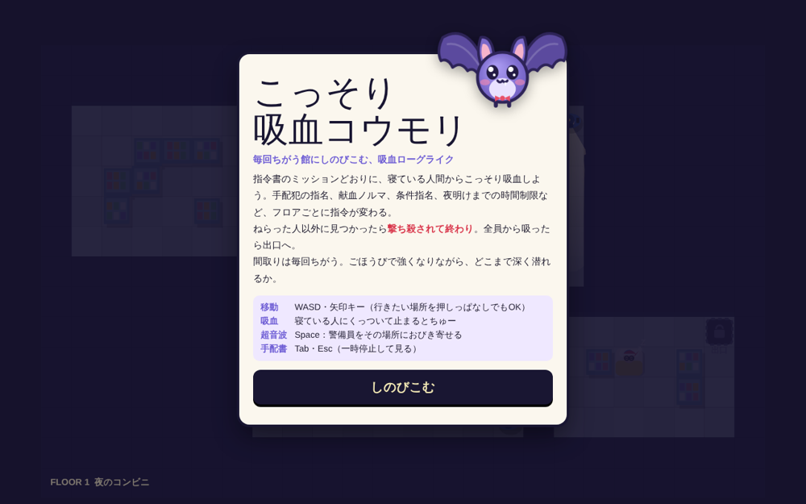
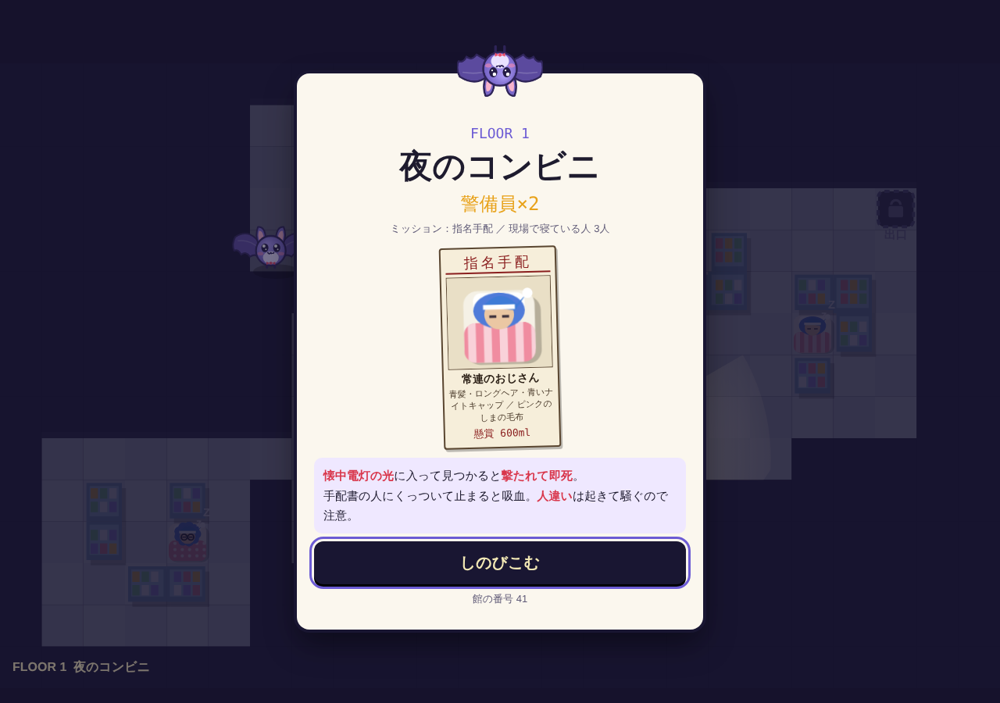
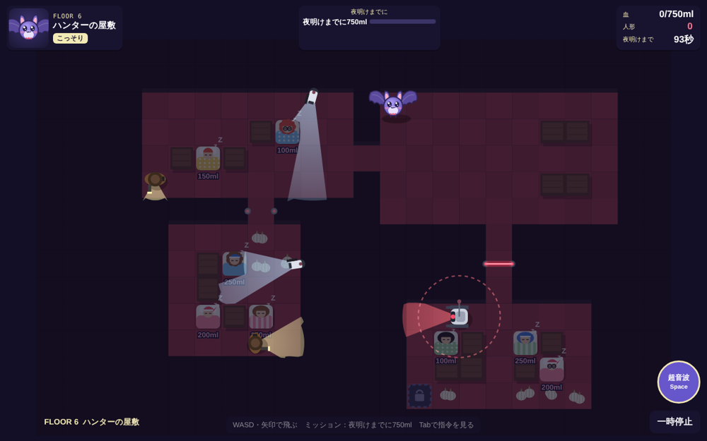
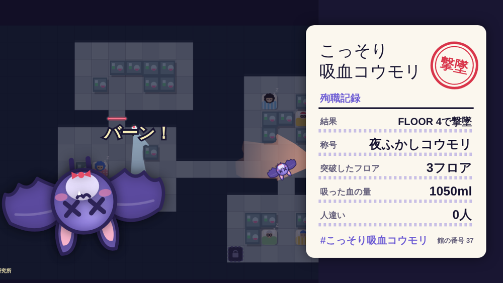

# こっそり吸血コウモリ

**毎回ちがう館にしのびこむ、吸血ローグライク。**

コウモリになって夜の建物にしのびこみ、指令書のミッションどおりに寝ている人間からこっそり吸血して脱出するバカゲーです。
ねらった人以外に見つかったら撃ち殺されて終わり。ごほうびで強くなりながら、どこまで深く潜れるか。

ゲームプレイ：https://ibaran1um.github.io/kossori-bat/

## 遊び方

1. フロアの前に **指令書** が配られます
2. 警備員やカメラの光をさけながら、寝ている人にくっついて止まると **吸血**
3. ミッションを達成すると出口が開くので、出口まで飛んで **脱出**
4. 脱出するたびに **ごほうび** を3つから1つ選んで、次のフロアへ

光の中に入ると「？」のメーターがたまり、いっぱいになると見つかって **撃たれて即死** です。
メーターがたまりきる前に光の外へ逃げれば、まだ間に合います。

## ミッション

| ミッション | 内容 |
|---|---|
| 指名手配 | 手配書（寝姿の写真と特徴）の人物を全員吸う。そっくりな無関係の人も寝ている |
| 献血ノルマ | 誰でもいいから○ml吸う。1人 100〜250ml、多い人ほど時間がかかる |
| 条件指名 | 「メガネの人を全員」「水玉の毛布の人を全員」など |
| 夜明けまでに | 制限時間内に○ml。間に合わないと朝日で灰になる |

指名手配と条件指名で **人違い** をすると、太って遅くなるうえ、相手が起きて騒ぎ、近くの警備員がかけつけてきます。

## 館について

- 間取り・見張り・仕掛け・寝ている人の配置は毎回自動で作られます。終わりはありません
- 下の階ほど警備員が増え、見つかりやすくなります
- 3階から **銃座カメラ**、4階から **レーザー**、5階から **ロボット**、6階から **ニンニク** の床が登場します

## ごほうび

はやい羽 ／ ストロー牙（吸血が速い）／ 大きな耳（超音波の待ち時間短縮）／ 気配けし（見つかりにくい）／ のびる胃袋（太っても遅くなりにくい）／ ニンニク耐性 ／ 身代わり人形（1回だけ弾が当たっても助かる）／ ちび化（当たり判定が小さい）／ でかい声（超音波が遠くまで届き、ロボットもだませる）

## 操作

| | PC | スマホ |
|---|---|---|
| 移動 | WASD・矢印キー（押しっぱなしでもOK） | 行きたい場所を指で押しっぱなし |
| 吸血 | 寝ている人にくっついて止まる | くっついて指をはなす |
| 超音波 | Space（警備員をその場所におびき寄せる） | 右下のボタン |
| 指令書を見る | Tab・Esc（一時停止） | 画面上の指令書をタップ |

## 結果のポスト

撃たれると、突破したフロア数・吸った血の量・称号（こうもり見習い〜伝説の吸血鬼）が出ます。
「結果をポストする」から、結果画像付きで X にポストできます（タグ：#こっそり吸血コウモリ）。

- スマホ：共有メニューから画像付きでポスト
- PC：画像をコピーしてから X のポスト画面が開くので、貼り付け（Ctrl+V / ⌘V）

### 館の番号

同じ「館の番号」なら同じ間取りになります。URL に `?seed=番号` を付けるとその館で遊べます（ポストの URL にも付きます）。
例：https://ibaran1um.github.io/kossori-bat/?seed=41

## 公開のしかた（GitHub Pages）

1. GitHub で新しいリポジトリ `kossori-bat` を作る（Public）
2. このフォルダの中身（`index.html` `README.md` `images/` `.nojekyll`）をリポジトリ直下にアップロード
3. Settings → Pages → Build and deployment の Source を「Deploy from a branch」、Branch を `main` / `/(root)` にして Save
4. 数分後に https://ibaran1um.github.io/kossori-bat/ で遊べます

リポジトリ名を変えた場合は、この README の URL もあわせて書き換えてください。

## 調整したいとき（index.html）

| 場所 | 内容 |
|---|---|
| `HASHTAG` | ポストのハッシュタグ |
| `CFG` | コウモリの速さ、吸血時間、撃たれるまでの時間など |
| `floorPlan` | 階ごとの警備員・カメラ・レーザー・ロボット・寝ている人の数 |
| `PERKS` | ごほうびの種類と効果 |
| `tryGen` の「ミッション」部分 | ミッションの出やすさ、ノルマの量、制限時間 |

ファイルは `index.html` 1つだけで動きます（サーバー不要）。自己ベストはブラウザに保存されます。

---

制作：[ibaran1um](https://github.com/ibaran1um)
